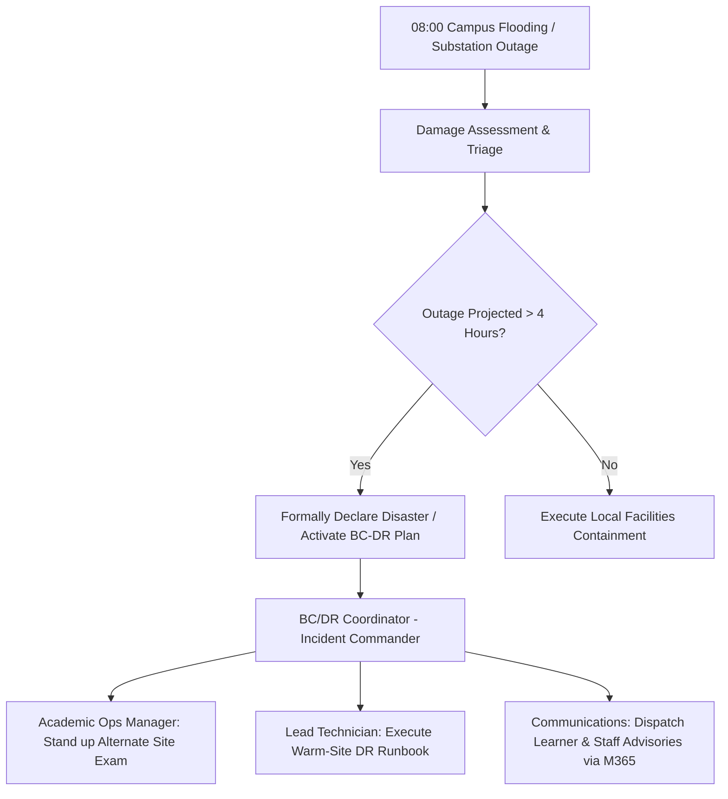

# GRC205: Business Continuity & Disaster Recovery (BC/DR) Assessment
### Northbridge Skills Institute — Business Impact Analysis, Recovery Objectives, Strategy Selection, and Coordinated Continuity Plan

[](#academic--assessment-metadata)
[](#standards-alignment--governance-framework)
[-teal.svg)](#iso-22301-climate-action-amendment)
[-orange.svg)](#task-3-recovery-strategy-selection--budget-allocation)
[](#primary-assessment-documents)

---

## Primary Assessment Documents

The complete, unabridged laboratory assessment report (~3,350 words, including itemized financial matrices, technical recovery runbooks, tabletop inject analyses, RACI accountability charts, and governance frameworks) is available in both PDF and DOCX formats:

| Format | Document Link | Description | Primary Use Case |
| :--- | :--- | :--- | :--- |
| **PDF** | [**View / Download PDF Report**](GRC205_BCDR_Assignment_GCR2512878.pdf) | Official formatted academic and executive submission copy (12 pages, high-resolution layout and tables). | Direct review, grading, digital circulation, and executive printing. |
| **DOCX** | [**Download Word Document**](GRC205_BCDR_Assignment_GCR2512878.docx) | Fully structured Microsoft Word artifact with complete headings, tabular models, and metadata. | Archival inspection, institutional repository indexing, and template reuse. |

> **Direct Access Note**: Click the links above to open the files directly within GitHub's file previewer or download them for local viewing in Adobe Acrobat or Microsoft Word.

---

## Academic & Assessment Metadata

* **Institution:** International Cybersecurity and Digital Forensics Academy (ICDFA)
* **Curriculum:** Governance, Risk, and Compliance (GRC) Professional Series
* **Module Code & Title:** GRC205 — Incident Management and Business Continuity
* **Assignment Session:** Week 21 Laboratory Assessment
* **Candidate Name:** Samuel Adeoluwa Okunribido
* **Candidate ID:** `GCR2512878`
* **Institutional Email:** `gcr2512878@students.icdfa.edu.ng`
* **Assessment Date:** October 2026
* **Word Count (Report Body):** Approximately 3,350 words

---

## Executive Summary & Scenario Context

This repository contains the end-to-end Business Continuity and Disaster Recovery (BC/DR) response plan for the fictional **Northbridge Skills Institute** following a sudden, catastrophic dual crisis: an intense regional storm causing physical campus flooding and an electrical substation failure at **08:00 on Day 0**. The primary physical facility is declared entirely inaccessible for an estimated minimum of **72 hours**.

Northbridge Skills Institute serves **1,800 active learners** supported by **90 staff members**. The incident occurs precisely three hours prior to a critical, non-negotiable **11:00 high-stakes examination** affecting 120 candidates, with cascading deadlines across student fees (16:00 Day 0), admissions closure (18:00 Day 0), and monthly payroll bank submissions (12:00 Day 1).

```mermaid
timeline
    title Incident Timeline & Operational Constraints (Day 0 - Day 1)
    08:00 : Disaster Trigger (Flood & Power Outage) : Site inaccessibility estimated at 72h
    08:00 - 11:45 : Technical Recovery Critical Path (Network -> AUTH01 -> Security -> DB01 -> LMS01)
    10:00 : Alternate Site Workstations Available (25 seats available)
    11:00 : High-Stakes Exam Scheduled (120 learners) : F1 Temporary Continuity Invigilation Required!
    11:45 : LMS01 Online : First Electronic Assessment System Available
    12:30 : Full Functional IT Recovery : All 5 core services restored at Warm Site
    16:00 : Student Fee Confirmation Cut-off (F2) : External payment logs & manual verification
    18:00 : Admissions Application Closure (F3) : Batch intake processing
    Day 1 12:00 : Staff Payroll Bank Dispatch Cut-off (F4) : Pre-approved draft reconciliation
```

### Key Analytical Findings & Decisions

1. **Strategic Selection (Warm-Site Package):** Evaluated against Cold, Warm, and Hot configurations under an annual budget ceiling of **NGN 3,000,000**. The Warm-Site strategy—incorporating mandatory independent backup storage (NGN 400,000) and structured testing/training (NGN 200,000)—totals **NGN 2,100,000/year**, leaving a prudent NGN 900,000 contingency reserve.
2. **The 45-Minute Exam Gap:** Baseline two-technician recovery modeling reveals that Learning Management System (`LMS01`) restoration cannot conclude until **11:45** (45 minutes after the scheduled 11:00 examination start). This establishes that **technical DR cannot substitute for business continuity**; robust manual and BYOD continuity workarounds must absorb the gap.
3. **Financial Disruption vs. Investment ROI:** The unmitigated financial cost of downtime is calculated at **NGN 1,200,000 after 8 hours** and **NGN 3,360,000 after 24 hours**. A single 24-hour disruption exceeds the entire annual cost of the recommended Warm-Site capability (NGN 2,100,000), proving a compelling business case for leadership investment.
4. **Enhanced Data Protection (3-2-1 Architecture):** Current checkpoint audits revealed substantial RPO vulnerabilities (up to 9-hour loss on full backups and 8-hour gap on Active Directory). The report engineers an upgraded backup architecture featuring hourly change-data-capture (CDC) / incrementals, 4-hour directory snapshots, and weekly air-gapped, immutable offline repositories.

---

## Task 1: Business Impact Analysis (BIA)

A rigorous Business Impact Analysis was conducted across Northbridge Skills Institute's five mission-critical operational functions, evaluating direct hourly financial losses, fixed penalty triggers, and non-financial exposures (learner welfare, regulatory compliance, institutional reputation, and record integrity).

### Critical Function Profile

| ID | Function Name | Supporting Infrastructure | Lead Owner | Disruption Rate (NGN/hr) | Key Deadline / Operational Driver | Recovery Priority |
| :--- | :--- | :--- | :--- | :--- | :--- | :---: |
| **F1** | **Teaching and Assessment** | `LMS01`, `DB01`, `AUTH01` | Academic Operations Manager | NGN 60,000 | **11:00 Day 0** (High-stakes exam; NGN 120,000 one-off cancellation penalty) | **Priority 1** |
| **F2** | **Fees and Finance** | `FIN01`, `DB01`, `AUTH01` | Finance Manager | NGN 40,000 | **16:00 Day 0** (Institutional fee confirmation deadline) | **Priority 2** |
| **F3** | **Admissions and Registration** | `REG01`, `DB01`, `AUTH01` | Admissions Officer | NGN 20,000 | **18:00 Day 0** (Enrollment closure deadline) | **Priority 3** |
| **F4** | **Staff Payroll** | `HR01`, `DB01`, `AUTH01` | Human Resources Manager | NGN 10,000 | **12:00 Day 1** (Bank transmission cut-off for 90 personnel) | **Priority 4** |
| **F5** | **Records and Certificates** | `FS01`, `AUTH01` | Registry Manager | NGN 5,000 | **48-Hour SLA** (Official verification commitment) | **Priority 5** |

### Cumulative Disruption Cost Matrix

Cost modeling treats hourly financial impact as additive, non-overlapping incremental losses, incorporating the one-off examination cancellation penalty at 11:00:

```
Combined 8-Hour Loss (08:00 - 16:00):      NGN 1,200,000
Combined 24-Hour Loss (08:00 - 08:00 Day 1): NGN 3,360,000
```

| Function | Hourly Rate | 8-Hr Sub-Total | 8-Hr One-Off | 8-Hr Total (NGN) | 24-Hr Sub-Total | 24-Hr One-Off | 24-Hr Total (NGN) |
| :--- | :---: | :---: | :---: | :---: | :---: | :---: | :---: |
| **F1: Teaching** | NGN 60,000 | NGN 480,000 | NGN 120,000 | **NGN 600,000** | NGN 1,440,000 | NGN 120,000 | **NGN 1,560,000** |
| **F2: Finance** | NGN 40,000 | NGN 320,000 | — | **NGN 320,000** | NGN 960,000 | — | **NGN 960,000** |
| **F3: Admissions** | NGN 20,000 | NGN 160,000 | — | **NGN 160,000** | NGN 480,000 | — | **NGN 480,000** |
| **F4: Payroll** | NGN 10,000 | NGN 80,000 | — | **NGN 80,000** | NGN 240,000 | — | **NGN 240,000** |
| **F5: Records** | NGN 5,000 | NGN 40,000 | — | **NGN 40,000** | NGN 120,000 | — | **NGN 120,000** |
| **Consolidated** | — | **NGN 1,080,000** | **NGN 120,000** | **NGN 1,200,000** | **NGN 3,240,000** | **NGN 120,000** | **NGN 3,360,000** |

### Structural Dependency Risks

* **Single Point of Failure (SPOF):** The recovery network fabric and Active Directory/Authentication server (`AUTH01`) form an absolute bottleneck. A failure or configuration delay here arrests the entire recovery pipeline across all five functions.
* **Administrative Identity Conflation:** System administration credentials for operational infrastructure and secondary backup repositories were found to be shared, creating a catastrophic privilege escalation and ransomware propagation exposure.
* **Technician Concurrency Bottleneck:** Staffing is strictly constrained to **two qualified IT technicians**. Because core restoration tasks cannot be subdivided, parallel recovery is only possible when common prerequisites are satisfied and both technicians are disengaged.

---

## Task 2: Recovery Objectives & Resilient Backup Architecture

### Target Recovery Metrics (RTO / RPO / MTD)

To protect institutional solvency and academic accreditations, distinct tolerances were calibrated. A deliberate operational safety buffer is embedded between the technical **Recovery Time Objective (RTO)** and the **Maximum Tolerable Downtime (MTD)** to allow for data integrity validation and reconciliation:

| Function | Proposed RTO | Proposed RPO | Maximum Tolerable Downtime (MTD) | Operational Safety Buffer | Service-Level Declaration |
| :--- | :---: | :---: | :---: | :---: | :--- |
| **F1 Teaching** | **3 Hours** | **1 Hour** | **5 Hours** | 2 Hours | `LMS01` accessible; secure online/hybrid exam delivered. |
| **F2 Fees** | **6 Hours** | **2 Hours** | **10 Hours** | 4 Hours | `FIN01` online or dual-controlled manual transaction logging. |
| **F3 Admissions**| **8 Hours** | **4 Hours** | **12 Hours** | 4 Hours | `REG01` restored or controlled intake paper queue active. |
| **F4 Payroll** | **20 Hours** | **4 Hours** | **28 Hours** | 8 Hours | `HR01` validated; dual sign-off prior to bank clearinghouse. |
| **F5 Records** | **24 Hours** | **12 Hours** | **48 Hours** | 24 Hours | `FS01` restored; hash integrity verified against baseline. |

### Baseline Checkpoint Vulnerability Audit (at 08:00 Disruption)

* **B01: `DB01` Full Backup (23:00 Day -1):** 9 hours old at impact. *Exceeds proposed RPOs for F1, F2, F3, and F4.*
* **B02: `DB01` Incremental (07:00 Day 0):** 1 hour old at impact. *Satisfies F1 RPO (1 hr) and falls within F2–F4 limits.*
* **B03: `AUTH01` Directory Snapshot (00:00 Day 0):** 8 hours old. *Exceeds all standard directory service targets.*
* **B04: `FS01` File System Full (23:00 Day -1):** 9 hours old. *Within F5 acceptable boundary (12 hrs).*

### Redesigned Enterprise 3-2-1 Backup Topology

To guarantee recoverability without data loss exceeding agreed RPOs, a modernized backup matrix is established:

```
[Production Systems] 
       │
       ├──► 1. Daily Onsite Encrypted Disk Snapshots (Fast Recovery)
       ├──► 2. Hourly Deduplicated Object Storage Offsite (Replication)
       └──► 3. Weekly Air-Gapped Immutable Media (Ransomware Defense)
```

```
DB01 Database:
  • Full Backup: Daily @ 23:00 | Dual-key encryption | 14-day onsite / 30-day offsite retention
  • Incremental / CDC: Every 60 minutes | Cryptographic checksum per write | 15-minute alert threshold
AUTH01 Active Directory:
  • System State Snapshot: Every 4 hours | 7-day rolling retention | Dedicated directory admin credentials
FS01 File System:
  • Full Backup: Daily @ 23:00 | Preserved ACLs | SHA-256 baseline hashing at capture
Immutable Offline Vault:
  • Air-Gapped Storage: Weekly (Saturdays @ 02:00) | Dual-custody physical retrieval controls | 12-week retention
```

---

## Task 3: Recovery Strategy Selection & Budget Allocation

### Strategic Option Evaluation

Three architectural packages were evaluated against the institute's NGN 3,000,000 statutory planning ceiling:

```
Option A: Cold-Site Facility      [NGN 1,200,000/yr]  --> Unacceptable RTO (24-48h)
Option B: Warm-Site Facility      [NGN 2,100,000/yr]  --> SELECTED (Balanced, Viable RTO/RPO)
Option C: Hot-Site Mirror         [NGN 3,000,000/yr]  --> Budget-Exhausting (High Corruption Propagation Risk)
```

| Evaluation Criteria | Cold-Site Package | Warm-Site Package (Recommended) | Hot-Site Package |
| :--- | :--- | :--- | :--- |
| **Base Infrastructure Fee** | NGN 600,000 | **NGN 1,500,000** | NGN 2,400,000 |
| **Mandatory Backup Add-on** | NGN 400,000 | **NGN 400,000** | NGN 400,000 |
| **Testing & Training Add-on** | NGN 200,000 | **NGN 200,000** | NGN 200,000 |
| **Total Annual Investment** | **NGN 1,200,000** | **NGN 2,100,000** | **NGN 3,000,000** |
| **Remaining Budget Buffer** | NGN 1,800,000 | **NGN 900,000 (30% Reserve)** | NGN 0 (Zero Contingency) |
| **First Service Availability** | 24 – 48 Hours | **3 – 5 Hours** | < 1 Hour (Synchronous) |
| **F1 (Exam) RTO/RPO Compliance**| Fails completely | **Satisfies RTO; RPO within limits** | Satisfies both |
| **Logical Corruption Defense** | High (Isolated media) | **Moderate (Controlled restore chain)** | Low (Immediate replication risk) |

### Formal Recommendation Justification

The **Warm-Site package (NGN 2,100,000/year)** is recommended as the only commercially sound, technically viable solution. While the Hot-Site provides instantaneous failover, it exhausts 100% of the operational budget, leaving no contingency for hardware failures or software licensing, while introducing extreme vulnerability to real-time ransomware replication. The Cold-Site, while inexpensive, forces catastrophic service failures on F1, F2, and F3.

---

## Task 4: Operational BC/DR Plan & Governance

### Activation Criteria & Response Hierarchy

* **Activation Threshold:** Immediate declaration upon confirmation of main campus structural inaccessibility.
* **Escalation Protocol:** Automatic executive escalation if projected facility restoration exceeds 4 hours or if statutory compliance deadlines are jeopardized.
* **Emergency Communications:** Hosted cloud tenancy (**Microsoft 365**) operates outside campus physical infrastructure, providing resilient email, mobile messaging, and situation report broadcasting.



### Institutional RACI Accountability Matrix

*(**A** = Accountable | **R** = Responsible | **C** = Consulted | **I** = Informed)*

| Core BC/DR Response Activity | BC/DR Coordinator | Academic Operations | Finance Manager | HR Manager | Registry Manager | Technical & Facilities Lead |
| :--- | :---: | :---: | :---: | :---: | :---: | :---: |
| **Disaster Plan Activation & Declaration** | **A / R** | C | C | I | I | R / C |
| **F1 Temporary Assessment Continuity** | **A** | **R** | I | I | C | C |
| **Backup Integrity & Checksum Verification** | **A** | I | I | I | I | **R** |
| **Infrastructure & Database Restoration** | **A** | C | C | C | C | **R** |
| **Multi-Stakeholder Crisis Messaging** | **A / R** | R | C | C | C | I |
| **Controlled Return to Primary Facility** | **A** | R | R | C | R | **R** |

### 72-Hour Continuity Workaround Procedures

1. **F1 Assessment Workaround (25-Workstation Constraint):** The alternate site provides only 25 desktop stations for 120 exam candidates.
   * Priority access is allocated to the **40 candidates** requiring specialized accessibility software or lacking personal hardware (staggered shifts).
   * The remaining **80 candidates** utilize verified personal laptops (BYOD) connecting through isolated alternate-site Wi-Fi under dual invigilator supervision.
   * Emergency hardcopy paper assessments require Academic Board authorization, secure locked chain of custody, and post-recovery double-entry reconciliation.
2. **F2 Finance Operations:** Cloud payment gateway remains operational. Local point-of-sale receipting shifts to numbered manual carbon registers requiring dual sign-offs. Zero manual adjustments permitted on learner wallets until `FIN01` data validation.
3. **F3 Admissions Processing:** Controlled physical intake using unique reference numbers, held in fireproof transit storage for batch ingestion upon `REG01` restoration.
4. **F4 Payroll Continuity:** Pre-approved payroll authorization drafted from the last certified baseline, with mandatory dual sign-off from HR and Finance Directors prior to bank clearinghouse submission.
5. **F5 Registry Protocols:** Fulfillment of transcript and certificate requests deferred pending cryptographic verification of `FS01`.

---

## Task 5: Recovery Schedule Validation & Tabletop Exercise

### Two-Technician Restoration Schedule (Baseline Model)

Constrained by a **two-technician staff profile**, the restoration schedule was mapped strictly by technical prerequisites, where foundational infrastructure must be established before database and application instances can mount.

```mermaid
gantt
    title Northbridge Skills Institute: Baseline DR Restoration (08:00 - 12:30)
    dateFormat HH:mm
    axisFormat %H:%M
    
    section Foundation & Security
    Recovery Network Setup (Tech 1)       :a1, 08:00, 30m
    AUTH01 Active Directory (Tech 1)      :a2, 08:30, 30m
    Security & Checksum Validation (Tech 2) :a3, 09:00, 30m
    
    section Database & Core Storage
    DB01 Database Full + Incr (Tech 1)     :b1, 09:30, 90m
    FS01 File Repository (Tech 2)          :b2, 09:30, 60m
    
    section Application Services
    LMS01 Learning Platform (Tech 1)       :c1, 11:00, 45m
    FIN01 Financial Systems (Tech 2)       :c2, 11:00, 30m
    REG01 Admissions System (Tech 2)       :c3, 11:30, 30m
    HR01 Payroll Platform (Tech 1)         :c4, 11:45, 45m
```



### Detailed Sequence Log

| Recovery Step | Duration | Prerequisites | Assigned Engineer | Start Window | Completion Window | Target Milestone Status |
| :--- | :---: | :--- | :---: | :---: | :---: | :--- |
| **Recovery Network Deployment** | 30 min | None (Physical site access) | Tech 1 | 08:00 | 08:30 | Network fabric online |
| **`AUTH01` Directory Restoration**| 30 min | Recovery Network | Tech 1 | 08:30 | 09:00 | Identity services live |
| **Security & Checksum Audits** | 30 min | `AUTH01` | Tech 2 | 09:00 | 09:30 | Clean baseline verified |
| **`DB01` Database Recovery** | 90 min | Security Checks Passed | Tech 1 | 09:30 | **11:00** | Core data tier ready |
| **`FS01` Storage Recovery** | 60 min | `AUTH01` + Security Checks | Tech 2 | 09:30 | 10:30 | Shared storage ready |
| **`LMS01` Assessment Engine** | 45 min | `DB01` | Tech 1 | 11:00 | **11:45** | **Teaching Online (Exceeds 3h RTO by 45m)** |
| **`FIN01` Finance System** | 30 min | `DB01` | Tech 2 | 11:00 | 11:30 | Meets 6h RTO (4.5h buffer) |
| **`REG01` Admissions Platform** | 30 min | `DB01` | Tech 2 | 11:30 | 12:00 | Meets 8h RTO (4.0h buffer) |
| **`HR01` Payroll Engine** | 45 min | `DB01` | Tech 1 | 11:45 | **12:30** | **Full Functional Recovery Achieved** |

> **Critical Path:** `Recovery Network` $\rightarrow$ `AUTH01` $\rightarrow$ `Security Validation` $\rightarrow$ `DB01` $\rightarrow$ `LMS01` (Total: **225 minutes**).

### Tabletop Stress-Testing & CAPA Remediation

A simulated crisis exercise introduced four complex operational injects, resulting in a structured Corrective and Preventive Action (CAPA) plan:

```
[Inject 1: Extended 5-Day Outage] ──────► Formalize multi-day SLA & hotel lodging agreements
[Inject 2: Workstation Deficit (15)] ───► Contract mobile laptop cart vendor (48h dispatch)
[Inject 3: Incremental Integrity Fail] ──► Decouple admin credentials; hourly CDC backups
[Inject 4: Gateway Reconciliation Gap] ──► Implement automated end-of-day bank clearing API
```

1. **CAPA-01: Backup Identity Decoupling & Privileged Access Redesign**
   * *Target:* Revoke shared production domain admin privileges from backup repositories; establish dual-custody MFA vaults.
   * *Owner:* Lead Technical Architect | *Target Completion:* 30 Days.
2. **CAPA-02: High-Frequency Database Replication (30-Minute Windows)**
   * *Target:* Compress incremental backup frequency from 60 minutes to 30 minutes via Continuous Data Capture (CDC).
   * *Owner:* Database Administrator | *Target Completion:* 45 Days.
3. **CAPA-03: Alternate-Site Hardware Surge Capacity Agreement**
   * *Target:* Negotiate formal SLA with alternate-site provider for 20 additional emergency thin-client terminals.
   * *Owner:* Facilities Director | *Target Completion:* 60 Days.
4. **CAPA-04: Extended Outage Operational Runbook (Day 3 to Day 7)**
   * *Target:* Publish dedicated SOP for multi-week staff displacement, remote VPN access, and paper script storage.
   * *Owner:* BC/DR Coordinator | *Target Completion:* 45 Days.
5. **CAPA-05: External Payment Clearinghouse Automated Reconciliation**
   * *Target:* Deploy daily reconciliation scripts comparing external payment provider webhooks against `FIN01` ledger entries.
   * *Owner:* Finance Systems Analyst | *Target Completion:* 30 Days.

---

## Standards Alignment & Governance Framework

The Northbridge Skills Institute BC/DR plan is architected to align with international regulatory frameworks:

```
                 ┌────────────────────────────────────────────────────────┐
                 │       ISO 22301:2019 / NIST SP 800-34 Alignment        │
                 └──────────────────────────┬─────────────────────────────┘
                                            │
        ┌───────────────────────────────────┼──────────────────────────────────┐
        ▼                                   ▼                                  ▼
[Leadership & Policy]             [Risk & BIA Lifecycle]            [Resilience & Exercising]
Clause 5: RACI Authority          Clause 8.2: RTO/RPO Metrics       Clause 8.5: Bi-Annual Drills
SP 800-34 Phase 1: Policy         SP 800-34 Phase 2: BIA            SP 800-34 Phase 5: Testing
```

### NIST SP 800-34 Rev. 1 Alignment
* **Phase 1 (Contingency Planning Policy):** Established executive governance, activation thresholds, and delegated incident commander authority.
* **Phase 2 (Business Impact Analysis):** Calibrated outage costs, dependencies, and recovery prioritization for five critical systems.
* **Phase 3 (Preventive Controls):** Implemented the 3-2-1 backup scheme, hardware redundancy, and credential segmentation.
* **Phase 4 (Recovery Strategies):** Selected the Warm-Site model within the institutional budget ceiling.
* **Phase 5 (Plan Testing & Maintenance):** Institutionalized quarterly tabletops and scheduled runbook updates.

### ISO 22301:2019 / Amd 1:2024 (Climate Action Amendment)
Under the 2024 Climate Action changes to ISO management standards, climate-related vulnerabilities must be evaluated within business continuity governance. Because this disaster was initiated by severe regional flooding, the policy mandates:
* Annual hydrodynamic flood-zone re-evaluations for both primary and alternate facilities.
* Verification that alternate-site emergency power generators and diesel fuel storage are located above 100-year flood line projections.

### Enterprise Key Performance Indicators (KPIs)

| Metric ID | Indicator Description | Formula / Measurement Basis | Target Standard | Monitoring Cadence | Accountable Owner |
| :---: | :--- | :--- | :---: | :---: | :--- |
| **KPI-01** | **Recovery Compliance Rate** | $(\text{Systems Recovered within RTO} / \text{Total Critical Systems}) \times 100$ | **$\ge$ 90%** | Bi-Annual Exercise | BC/DR Coordinator |
| **KPI-02** | **Backup Integrity Coverage** | Quarterly isolated test restores successfully validating data integrity | **100% of Sets** | Monthly / Quarterly| Lead Systems Engineer |
| **KPI-03** | **CAPA Closure Velocity** | $(\text{Corrective Actions Closed on Schedule} / \text{Total Logged}) \times 100$ | **$\ge$ 85%** | Monthly Audit | Internal Audit / GRC |
| **KPI-04** | **BC/DR Training Adherence** | Staff completing annual role-specific continuity briefings within 30 days | **100%** | Annual Cycle | HR / Academic Ops |

### Maturity Model Evolution

* **Current Baseline (Managed - Level 2):** Policies documented, alternate warm-site contracted, baseline recovery schedules modeled, tabletop exercise completed.
* **12-Month Target (Defined - Level 3):** Full isolation sandbox testing validated, backup credentials entirely decoupled, 30-minute CDC operational, climate flood audits institutionalized.

---

## Repository Directory & Structure

```
GRC205_BCDR_ASSIGNMENT_GCR2512878/
│
├── README.md                                  # Executive summary, analytical dashboards, & lab overview
│
├── GRC205_BCDR_Assignment_GCR2512878.pdf     # Primary formal academic submission (12-Page Master Report)
│   ├── Executive Summary & Objectives
│   ├── Five-Function BIA & Disruption Matrices
│   ├── RTO/RPO/MTD Formulation & 3-2-1 Backup Topology
│   ├── Cold vs. Warm vs. Hot Cost-Benefit Analysis
│   ├── Coordinated BC/DR Plan, RACI Matrix, & Runbook
│   ├── Two-Technician Recovery Schedule & Gantt Model
│   ├── Tabletop Exercise Injects & CAPA Log
│   └── Governance, ISO 22301/NIST Mapping, & References
│
└── GRC205_BCDR_Assignment_GCR2512878.docx    # Microsoft Word submission document
```

---

## Academic Integrity & Submission Acknowledgement

This laboratory report was authored and compiled by **Samuel Adeoluwa Okunribido** (`GCR2512878`) in partial fulfillment of the requirements for **GRC205: Incident Management and Business Continuity** at the **International Cybersecurity and Digital Forensics Academy (ICDFA)**. 

In accordance with institutional guidelines on artificial intelligence, AI technologies were utilized solely for computational cross-validation, typographical refinement, and structural alignment. All risk assessments, strategic recommendations, financial analyses, and policy determinations reflect the independent academic evaluation and ethical responsibility of the student. All organizational names and scenario figures are simulated for instructional laboratory evaluation.
