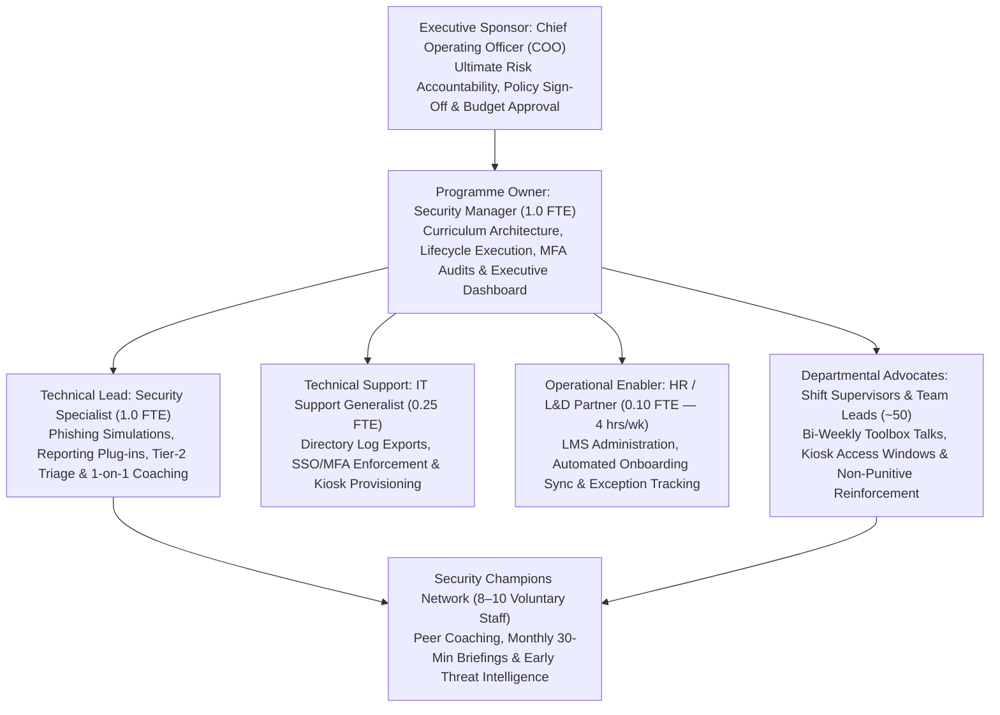
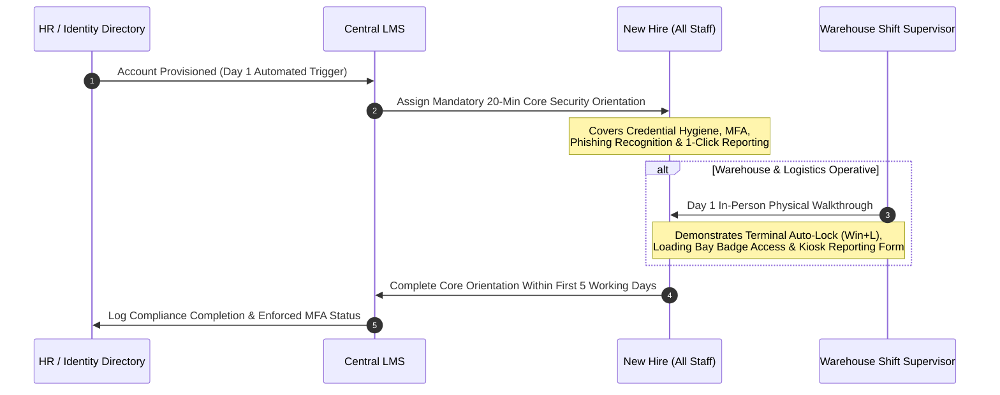

# GRC206 Security Awareness Programme — Northbridge Logistics Ltd.

> **Enterprise Security Behaviour & Culture Design: A Practical Operational Framework Grounded in the Five-Stage Security Awareness Lifecycle (`Assess → Plan → Deliver → Measure → Improve`)**

[-1E293B?style=for-the-badge)](./GRC206_Security_Awareness_Programme_Northbridge_Logistics_GCR2512878.pdf)

---

## Document Control & Academic Metadata

| Attribute | Specification |
| :--- | :--- |
| **Project Title** | GRC206 Security Awareness Programme — Northbridge Logistics: Enterprise Security Behaviour & Culture Design |
| **Course** | GRC206 — Information Governance, Risk and Compliance |
| **Target Organisation** | Northbridge Logistics Ltd. (National Third-Party Logistics / 3PL Provider, ~800 Employees) |
| **Author / Student Name** | **SAMUEL ADEOLUWA OKUNRIBIDO** |
| **Student ID** | `GCR2512878` (`2025/GCR/12878`) |
| **Official Email** | `gcr2512878@students.icdfa.edu.ng` |
| **Academic Year** | 2025 / 2026 |
| **Submission Date** | November 2026 |
| **Regulatory & Pedagogical Baseline** | NIST SP 800-50, ISO/IEC 27001:2022 (Control 7.2), NIST CSF 2.0, UK NCSC *You Shape Security*, ENISA Awareness Guidelines |

---

## Repository Deliverables

| File Artifact | Format | Description |
| :--- | :---: | :--- |
| [**`GRC206_Security_Awareness_Programme_Northbridge_Logistics_GCR2512878.pdf`**](./GRC206_Security_Awareness_Programme_Northbridge_Logistics_GCR2512878.pdf) | `PDF` | **Primary Deliverable (14 Pages):** Complete print-ready enterprise security awareness strategy, risk assessment, governance model, delivery playbooks, metrics scorecard, 12-month execution roadmap, and socio-technical analysis. |
| [**`GRC206_Security_Awareness_Programme_Northbridge_Logistics_GCR2512878.docx`**](./GRC206_Security_Awareness_Programme_Northbridge_Logistics_GCR2512878.docx) | `DOCX` | **Editable Source Document:** Formatted Microsoft Word manuscript containing all structured tables, policy charters, and operational appendices. |
| [**`README.md`**](./README.md) | `Markdown` | **Repository Documentation:** Executive and technical blueprint summarizing the full architecture, lifecycle stages, and quantitative governance model. |

---

## Table of Contents

1. [Executive Summary & Strategic Charter](#1-executive-summary--strategic-charter)
2. [Programme Objectives](#2-programme-objectives)
3. [Lifecycle Architecture & Operational Workflows](#3-lifecycle-architecture--operational-workflows)
4. [Tools, Capabilities & Organisational Assumptions](#4-tools-capabilities--organisational-assumptions)
5. [Task 1 — Assess: Risks, Audiences & Empirical Baseline](#5-task-1--assess-risks-audiences--empirical-baseline)
6. [Task 2 — Plan: Measurable Objectives, Governance & Curriculum Mapping](#6-task-2--plan-measurable-objectives-governance--curriculum-mapping)
7. [Task 3 — Deliver: Formats, Onboarding, Simulations & No-Blame Reporting](#7-task-3--deliver-formats-onboarding-simulations--no-blame-reporting)
8. [Task 4 — Measure: Performance Scorecard & Executive Dashboard](#8-task-4--measure-performance-scorecard--executive-dashboard)
9. [Task 5 — Improve & Sustain: Feedback Loops & Security Champions](#9-task-5--improve--sustain-feedback-loops--security-champions)
10. [12-Month Programme Execution Calendar](#10-12-month-programme-execution-calendar)
11. [Socio-Technical Analysis, Challenges & Engineered Mitigations](#11-socio-technical-analysis-challenges--engineered-mitigations)
12. [Strategic Recommendations & Reflective Synthesis](#12-strategic-recommendations--reflective-synthesis)
13. [References & Acknowledgements](#13-references--acknowledgements)

---

## 1. Executive Summary & Strategic Charter

**Northbridge Logistics Ltd.** is a mid-sized national third-party logistics (3PL) provider employing approximately **800 staff** across corporate headquarters, four regional fulfillment warehouses, and a distributed mobile sales force. The organisation faces a critical inflection point in its cyber risk posture following a series of recent security incidents—including sophisticated supplier impersonation and **Business Email Compromise (BEC)** attempts alongside two documented occurrences of **post-breach corporate credential reuse**. These operational vulnerabilities are compounded by the company's custody of sensitive, regulated commercial shipping data and personal information, creating substantial legal and regulatory exposure under data protection statutes.

This repository presents a practical, high-impact **12-Month Security Awareness Programme** engineered specifically around Northbridge Logistics' operational constraints:
- **Lean Security Headcount:** A 3-person cybersecurity team (Security Manager, Security Specialist, and 25% FTE IT Support generalist) supported by a 10% FTE HR/L&D Learning Partner.
- **Strict Fiscal Ceiling:** Annual awareness budget capped strictly at **£12,000–£15,000**, precluding expensive external consultancies.
- **Heterogeneous Workforce & Non-Desk Reality:** Over **56% of staff (~450 warehouse operatives)** operate on 24/7 rotating shifts with negligible desktop computer access.

Rather than deploying unfocused, annual "check-the-box" compliance training, this programme implements a calibrated, audience-segmented intervention model grounded in the **Five-Stage Security Awareness Lifecycle (`Assess → Plan → Deliver → Measure → Improve`)**, targeting three decisive behavioural vectors: **financial fraud verification**, **rigorous credential and multi-factor authentication (MFA) hygiene**, and **psychological safety-driven threat reporting**.

> [!IMPORTANT]
> ### Strategic Charter & Month-12 Target Outcomes
> - **$\ge 50\%$ Reduction** in confirmed successful invoice-fraud and unauthorized payment redirection (BEC) incidents, paired with **100% compliance** on out-of-band callback verification across Accounts Payable.
> - **$\ge 85\%$ Completion** of mandatory role-specific security modules across all four workforce cohorts by Month 6.
> - **$\ge 90\%$ Enforced Adoption** of enterprise Multi-Factor Authentication (MFA) across all active directory accounts by Month 9.
> - **$\le 8\%$ Phishing Click Rate** paired with **$\ge 40\%$ Active Suspicious Message Reporting Rate** across quarterly simulated campaigns by Month 12.

---

## 2. Programme Objectives

The primary objective of this project is to operationalize cybersecurity governance principles into an actionable, sustainable behaviour and culture transformation programme within a resource-constrained logistics environment:

1. **Lifecycle Alignment:** Design an end-to-end security behaviour change programme directly mapped to the five-stage lifecycle model (`Assess → Plan → Deliver → Measure → Improve`) in compliance with **NIST SP 800-50** and **ISO/IEC 27001:2022 Control 7.2**.
2. **Human Risk Mitigation:** Directly remediate Northbridge Logistics' empirical risk exposures—specifically Business Email Compromise (BEC), invoice redirection fraud, compromised credential reuse, and acute incident reporting friction.
3. **Audience-Specific Instructional Design:** Construct tailored pedagogical delivery models adapted to four distinct organisational cohorts, specifically solving the operational challenge of engaging non-desk warehouse shift workers without disrupting 24/7 fulfillment turnarounds.
4. **Quantitative Governance & Metrics:** Establish an objective, data-driven measurement framework spanning **Reach**, **Behaviour**, **Hygiene**, and **Real-World Outcomes**, supported by a quarterly executive reporting cadence.
5. **Operational Sustainability:** Demonstrate that meaningful security culture transformation can be achieved without enterprise-scale budgets or dedicated training headcount through pragmatic governance, onboarding automation, and continuous feedback loops.

---

## 3. Lifecycle Architecture & Operational Workflows

### 3.1 Five-Stage Security Awareness Lifecycle Architecture

```mermaid
flowchart LR
    subgraph S1["Stage 1: ASSESS (Month 1)"]
        A1["3 Human-Driven Risks"]
        A2["4 Workforce Cohorts (800 Staff)"]
        A3["30-Day Pre-Launch Baseline"]
    end

    subgraph S2["Stage 2: PLAN (Months 1–2)"]
        P1["3 Quantified 12-Month OKRs"]
        P2["5-Tier Governance Charter"]
        P3["Risk-Mapped Curriculum"]
    end

    subgraph S3["Stage 3: DELIVER (Months 2–11)"]
        D1["Role-Specific Micro & Live Formats"]
        D2["5-Day Automated Onboarding"]
        D3["Progressive Q1–Q4 Phishing Sims"]
        D4["No-Blame 1-Click & QR Reporting"]
    end

    subgraph S4["Stage 4: MEASURE (Monthly / Quarterly)"]
        M1["Reach: LMS Completion (≥85%)"]
        M2["Behaviour: Report Rate (≥40%)"]
        M3["Hygiene: MFA Enforced (≥90%)"]
        M4["Outcome: BEC Loss (-50%)"]
    end

    subgraph S5["Stage 5: IMPROVE & SUSTAIN (Months 3, 6, 9, 12)"]
        I1["Quarterly Steering Reviews"]
        I2["30-Day Remediation Tracker"]
        I3["Security Champions Network (8–10)"]
        I4["Monthly Security Spotter Award (£25)"]
    end

    S1 --> S2 --> S3 --> S4 --> S5
    S5 -. "Continuous Telemetry & Remediation Loop" .-> S2
    S5 -. "Dynamic Scenario Calibration" .-> S3
```

### 3.2 Governance & Escalation Topology

---

## 4. Tools, Capabilities & Organisational Assumptions

### 4.1 Vendor-Neutral Operational Resource Stack

The programme leverages existing, realistic capabilities standard to a mid-sized enterprise without requiring costly proprietary platforms:

| Resource / Capability | Operational Function | Architecture / Deployment Mode |
| :--- | :--- | :--- |
| **Existing Central LMS** | Module hosting, user assignment, SCORM tracking, completion and quiz score reporting. | Internal Learning Management System; web and mobile kiosk compatible. |
| **Central Identity & Access Directory** | Directory services, single sign-on (SSO), MFA enforcement, and authentication event auditing. | Directory audit logs exported via scheduled script to identify MFA gaps and breach hash collisions. |
| **Open / Modular Phishing Framework** | Simulated social engineering campaign execution, automated payload tracking, immediate landing page delivery. | Open-source or lightweight modular phishing simulation software operated directly by internal IT/Security staff. |
| **Internal Helpdesk Ticketing System** | Incident intake, triage categorization, resolution SLA tracking, and audit trail maintenance. | Designated security queue with custom tagging for employee suspicious message submissions. |
| **Collaborative Digital Channels** | Asynchronous company-wide announcements, digital bulletin boards, and shift-briefing distribution. | Standard corporate intranet and team messaging channels accessible on shared devices. |
| **Physical Operational Media** | Analogue visual reinforcement in industrial warehouse environments. | Laminated high-visibility job aids, loading bay visual posters, and shift handover briefing sheets. |

### 4.2 Baseline Organisational Assumptions & Constraints

- **Security Staffing Ceiling:** Strictly limited to **3 internal personnel**—one **Security Manager** (strategy, governance, policy), one **Security Specialist** (operations, simulations, triage), and one **IT Support generalist** allocating **25% FTE** to directory and log administration. No dedicated security communications staff exist.
- **L&D Partnership:** Human Resources / L&D contributes one shared **Learning Partner at 10% FTE (4 hours/week)** to assist with LMS user synchronization, automated onboarding enrollments, and shift training coordination.
- **Fiscal Constraints:** Total annual expenditure for awareness licensing, printing, recognition awards, and collateral is capped at **£12,000–£15,000**.
- **Workforce Distribution (800 Staff):**
  - **Warehouse & Logistics Operatives (~450 staff / 56.25%):** 24/7 rotating shifts across 4 regional hubs with negligible personal computer access.
  - **Head Office, Finance & Administration (~150 staff / 18.75%):** Based at corporate headquarters with dedicated desktop terminals.
  - **Remote Sales & Field Operations (~150 staff / 18.75%):** Operating across dynamic geographic territories using laptops and smartphones.
  - **Line Managers & Supervisors (~50 staff / 6.25%):** Distributed across all regional hubs and corporate functions.
- **Technical & Telemetry Boundaries:** Corporate identity directories log authentication timestamps and MFA status but lack automated behavioural AI risk scoring. Helpdesk ticketing supports email ingestion and custom tags but lacks automated malware sandbox detonation.

---

## 5. Task 1 — Assess: Risks, Audiences & Empirical Baseline

### 5.1 Top Three Human-Driven Risks

| Priority Risk Vector | Threat Dynamics | Organisational Vulnerability | Potential Business & Regulatory Impact |
| :--- | :--- | :--- | :--- |
| **Risk 1: Business Email Compromise (BEC) & Invoice Redirection Fraud** | Attackers target Northbridge's commercial supply chain via social engineering, impersonating known logistics suppliers, subcontractors, or executives requesting urgent bank account changes or expedited disbursements. | Accounts Payable and procurement operate under aggressive fulfillment SLAs; remote sales and operational staff frequently transmit informal billing requests via email while off-site. | Catastrophic direct financial capital loss via unauthorized wire transfers, secondary breach of regulated customer shipping data, severe reputational harm, and regulatory reporting triggers. |
| **Risk 2: Password Reuse & Weak Credential Hygiene** | Exploitation of employee credential reuse across consumer and corporate accounts; automated credential-stuffing attacks launched against perimeter portals following third-party breaches. | Two documented incidents of post-breach password reuse occurred recently; warehouse staff share administrative terminals without individual logout; legacy systems have incomplete MFA coverage. | Unauthorized administrative or network penetration, privilege escalation, ransomware deployment across logistics operational technology (OT), and data privacy sanctions. |
| **Risk 3: Low Recognition & Friction-Laden Threat Reporting** | Opportunistic and targeted credential-harvesting, malicious shipping attachments, and QR code phishing (**quishing**) concealed inside legitimate-looking logistics notices. | Operatives and field sales process hundreds of fast-paced manifests daily on mobile screens; lack of a frictionless reporting route plus fear of disciplinary reprisal causes staff to delete or ignore threats. | Extended latent dwell time for undetected intrusions, loss of SOC/security team visibility into active phishing waves, and severely delayed incident containment. |

### 5.2 Audience Segmentation Matrix (800 Staff)

| Audience Segment | Headcount | Operational Reality & Access Constraints | Core Pedagogical & Security Focus |
| :--- | :---: | :--- | :--- |
| **Warehouse & Logistics Operatives** | `~450` (56.25%) | Dynamic warehouse environments; 24/7 rotating shifts; no dedicated PCs; access via shared floor kiosks, wall-mounted tablets, or personal smartphones. | Physical perimeter security, loading bay social engineering, tailgating prevention, terminal auto-lock (`Win+L`), QR phishing (*quishing*), quick kiosk reporting. |
| **Head Office: Finance, HR & Procurement** | `~150` (18.75%) | Dedicated desk terminals; high daily volume of financial, contractual, and sensitive personal employee/customer data. | Mandatory out-of-band phone verification for payment changes, dual-authorization enforcement, payroll fraud detection, spear-phishing triage. |
| **Remote Sales & Field Operations** | `~150` (18.75%) | Highly mobile domestic/field travel; access corporate systems via laptops/smartphones over public Wi-Fi; fast-paced deal closing. | Public Wi-Fi hazards, mandatory VPN discipline, visual eavesdropping (privacy screens), device theft/loss containment, off-site client payment verification. |
| **People Managers & Team Leaders** | `~50` (6.25%) | Direct supervisory authority across warehouse hubs and functional departments; gatekeepers of team operational time. | Fostering non-punitive security culture, modeling compliance, running 2-minute shift briefings, incident escalation, psychological safety. |

### 5.3 Pre-Launch 30-Day Empirical Baseline Assessment

Prior to launching instructional content in Month 2, a formal 30-day empirical baseline (`M01`) establishes authentic risk telemetry:
1. **Diagnostic Phishing Benchmark:** Single, benign, unannounced simulation across all corporate mailboxes using a standard delivery notification lure to record unconditioned baseline **Click Rate** and **Report Rate**.
2. **Identity & Access Audit:** Scripted extraction of directory authentication telemetry to quantify current enterprise MFA enrollment, catalog legacy single-factor exceptions, and screen corporate emails against verified public breach databases.
3. **Historical Incident Telemetry Review:** 6-month retrospective audit of helpdesk security tickets and finance logs to quantify confirmed invoice-fraud attempts, near-misses, and voluntary suspicious email submissions.
4. **Knowledge & Perception Diagnostic Survey:** Anonymous 10-question pulse survey measuring workforce familiarity with payment verification protocols, password manager adoption, and perceived cultural barriers or fears around reporting mistakes.

---

## 6. Task 2 — Plan: Measurable Objectives, Governance & Curriculum Mapping

### 6.1 Three Measurable 12-Month Objectives

| Objective | Metric Category | Quantified Target & Horizon | Operational Control Anchor |
| :--- | :---: | :--- | :--- |
| **Objective 1: Invoice Fraud & BEC Incident Suppression** | **Outcome Metric** | **$\ge 50\%$ reduction** in confirmed successful invoice fraud and unauthorized payment redirection incidents by **Month 12** (vs. baseline). | **100% compliance** with out-of-band callback verification across Accounts Payable for any bank detail modification over £1,000. |
| **Objective 2: Enterprise Curriculum Reach & Credential Hygiene** | **Reach & Hygiene Metric** | **$\ge 85\%$ completion** of mandatory role-specific modules across all 4 cohorts by **Month 6**; **$\ge 90\%$ verified MFA adoption** across all active directory accounts by **Month 9**. | Automated LMS onboarding sync and monthly directory audit scripts. |
| **Objective 3: Resilience Elevation & Threat Reporting** | **Behavioural Metric** | **$\ge 40\%$ employee suspicious message reporting rate** across quarterly simulated campaigns by **Month 12**, while compressing phishing click susceptibility to **$\le 8\%$** enterprise-wide. | Single-click email reporting plugin, warehouse kiosk QR forms, and codified No-Blame Culture Charter. |

### 6.2 Programme Governance Framework

| Governance Role | Designated Stakeholder | Core Responsibilities & Decision Authority |
| :--- | :--- | :--- |
| **Executive Sponsor** | **Chief Operating Officer (COO)** | Holds ultimate accountability for enterprise operational risk; approves £12k–£15k budget allocation; signs off on mandatory policies; unblocks regional warehouse logjams. |
| **Programme Owner** | **Security Manager (1.0 FTE)** | Owns end-to-end curriculum architecture, lifecycle execution, metric analysis, quarterly one-page Executive Dashboard authoring, and quarterly steering reviews. |
| **Technical Lead** | **Security Specialist (1.0 FTE)** | Operates modular phishing simulation platform, configures reporting plugins/QR forms, engineers curriculum delivery assets, and conducts Tier-2 triage & 1-on-1 coaching. |
| **Operational Enabler** | **L&D Partner (0.10 FTE / 4h wk)** | Oversees LMS catalog configuration, manages automated HR-to-LMS enrollment sync, monitors shift-level compliance exceptions, and embeds modules into new-hire onboarding. |
| **Departmental Advocates** | **Shift Supervisors & Team Leads (~50)** | Serve as on-the-ground champions; facilitate bi-weekly 2-minute Toolbox Talks; reinforce non-punitive messaging; guarantee kiosk access during shift handovers. |

### 6.3 Curriculum Topics Mapped Directly to Empirical Risks

| Risk Vector Addressed | Target Audience | Instructional Content & Behavioural Imperative |
| :--- | :--- | :--- |
| **BEC & Invoice Redirection** | Head Office (Finance/Procurement) & Remote Sales | Mandatory out-of-band verification via known phone numbers on file for any bank detail amendment; dual-authorization controls; identifying spoofed vendor domains. |
| **Credential Reuse & Weak Hygiene** | All Workforce Segments *(Universal)* | Passphrase generation techniques; unique credential discipline; dangers of personal-professional password overlap; step-by-step MFA setup and token security. |
| **Under-Reporting & Phishing** | All Workforce Segments *(Universal)* | Recognizing social engineering psychological triggers (urgency, authority, fear); identifying *quishing* / malicious QR codes; using the 1-click and kiosk reporting mechanisms. |
| **Physical Security & Terminal Access** | Warehouse & Logistics Operatives | Preventing loading bay tailgating; physical security around dispatch computers; immediate workstation locking (`Win+L` / terminal logout); challenging/reporting unidentified visitors. |
| **Mobile & Remote Threat Vectors** | Remote Sales & Field Operations | Securing public Wi-Fi via mandatory VPN; preventing visual eavesdropping with privacy screens in transit; immediate containment and reporting protocols for lost/stolen devices. |

---

## 7. Task 3 — Deliver: Formats, Onboarding, Simulations & No-Blame Reporting

### 7.1 Delivery Formats Tailored to Operational Realities

- **Warehouse Operatives (`~450`): Micro-Learning & Operational Touchpoints**
  - Ultra-short **3-to-5 minute interactive modules** deployed via mobile-responsive LMS links on personal smartphones or shared warehouse floor touchscreen kiosks during pre-shift briefings.
  - Reinforced by **laminated high-visibility job aids** mounted at dispatch stations and supervisor-led **2-minute "Toolbox Talks"** delivered bi-weekly at shift handovers.
- **Head Office & Finance (`~150`): Scenario Workshops & Interactive Branching Modules**
  - **15-to-20 minute desktop e-learning modules** featuring interactive branching decisions.
  - Supplemented by **bi-annual, 45-minute live tabletop exercises** for Finance and Procurement simulating an active, high-urgency supplier bank account change request to pressure-test dual-control callback verification.
- **Remote Sales & Field Staff (`~150`): Mobile-First Audio/Visual Digests**
  - **Podcast-style 5-minute audio briefings**, mobile-optimized micro-scenarios, and push notifications via corporate collaboration channels designed for safe consumption during transit downtime without requiring desktop access.
- **People Managers (`~50`): Coaching Toolkits & Discussion Guides**
  - Concise, **single-page briefing cards** detailing shift talking points, observable safe security behaviours, and supportive protocols for handling employee-reported security mistakes.

### 7.2 New Starter Onboarding Pathway (First 5 Working Days)

### 7.3 Phishing Simulation Strategy: Constructive, Progressive & Non-Punitive

Simulations run **quarterly** as pedagogical reinforcement rather than punitive compliance traps:
- **Progressive Quarterly Difficulty:**
  - **Q1 (`M03`):** Basic credential-harvest lures with clear external indicators.
  - **Q2 (`M06`):** Logistics delivery and dispatch tracking lures tailored to 3PL operations.
  - **Q3 (`M08`):** Sophisticated internal operational notices targeting Remote Sales and Office cohorts.
  - **Q4 (`M11`):** Advanced supplier invoice modification and payment redirection scenarios targeting Finance and Remote staff.
- **Immediate Teachable Moments:** Clicking a simulated link redirects the employee to a respectful, non-judgmental landing page highlighting the specific social engineering red flags present in that message.
- **Psychological Safety & Strict Data Privacy:** Individual simulation outcomes remain **strictly confidential** to the cybersecurity team. Line managers receive only **aggregated, anonymized department-level metrics**. Simulation clicks are never used in disciplinary proceedings or performance appraisals.
- **Supportive Repeat-Clicker Coaching:** Employees who click two consecutive simulations attend a supportive **1-on-1 coaching session** with the Security Specialist (`M09`) to diagnose workflow pressures and build practical recognition habits.

### 7.4 Frictionless, No-Blame Reporting Infrastructure

To elevate active threat reporting to **$\ge 40\%$**, technical and cultural friction is systematically eliminated:
1. **Desktop & Mobile Email Users:** Integrated **single-click "Report Suspicious" email client plug-in** routing submissions directly to the helpdesk security queue.
2. **Non-Desk Warehouse Operatives:** Prominent **QR codes and desktop shortcuts on shared kiosk terminals** opening a simplified **3-field web submission form**.
3. **Closed-Loop Feedback SLA:** Automated appreciative confirmation receipt generated immediately, followed by a human/triage status update within **4 business hours**.
4. **Codified No-Blame Culture Charter:** Jointly signed by the **COO** and **HR Director**, guaranteeing in writing that no employee will face disciplinary action for reporting a genuine mistake, accidental phishing click, or security anomaly.

---

## 8. Task 4 — Measure: Performance Scorecard & Executive Dashboard

### 8.1 Four Core Performance Metrics Scorecard

| # | Metric Name & Type | Operational Definition & Calculation Formula | Data Source & Owner | Review Cadence & Target Milestone |
| :-: | :--- | :--- | :--- | :--- |
| **1** | **Curriculum Reach** *(Reach Metric)* | $$\text{Completion Rate (\%)} = \left(\frac{\text{Total Staff Completed Assigned Modules}}{\text{Total Target Population}}\right) \times 100$$ | **Source:** Central LMS Database **Owner:** L&D Partner | **Monthly Tracking** Target: **$\ge 85\%$** by **Month 6** across all 4 cohorts. |
| **2** | **Threat Reporting Rate** *(Behavioural Metric)* | $$\text{Reporting Rate (\%)} = \left(\frac{\text{Suspicious Message Reports}}{\text{Total Phishing Invocations}}\right) \times 100$$ | **Source:** Phishing Platform & Helpdesk **Owner:** Security Specialist | **Quarterly Review** Target: **$\ge 40\%$** reporting across campaigns by **Month 12** (Click rate **$\le 8\%$**). |
| **3** | **MFA Adoption Rate** *(Hygiene Metric)* | $$\text{MFA Rate (\%)} = \left(\frac{\text{Active Directory Accounts with Enforced MFA}}{\text{Total Active Accounts}}\right) \times 100$$ | **Source:** Directory Audit Logs **Owner:** Security Manager | **Monthly Review** Target: **$\ge 90\%$** enforced enterprise-wide by **Month 9**. |
| **4** | **Invoice Fraud Loss** *(Outcome Metric)* | Count of verified unauthorized payment modifications, successful BEC/fraud attempts, and logged near-misses. | **Source:** Finance ERP & Security Logs **Owner:** Security Manager & Head of Finance | **Quarterly Review** Target: **$\ge 50\%$** incident reduction by **Month 12**; **100%** AP callback compliance. |

### 8.2 Executive Reporting: The One-Page Quarterly Dashboard

At the close of each quarter (`M03`, `M06`, `M09`, `M12`), the Security Manager delivers a standardized **One-Page Executive Dashboard** to the Chief Operating Officer and Executive Committee containing four decision-focused components:
1. **Strategic OKR Trajectory:** High-level **RAG (Red / Amber / Green)** status indicators tracking progress against the three 12-month strategic objectives.
2. **Lifecycle Metric Scorecard:** Comparative table benchmarking current **Reach, Behaviour, Hygiene, and Outcome** telemetry against `M01` pre-launch baselines and quarterly milestones.
3. **Cohort Risk Heatmap:** Visual matrix pinpointing specific operational hubs or departments (e.g., *Regional Hub 2 Warehouse* vs. *Central Finance*) exhibiting training completion deficits or elevated phishing susceptibility.
4. **Actionable Executive Requests:** Concise narrative escalating systemic blockers requiring executive intervention (e.g., capital approval for hardware MFA tokens in cellular dead-zones or managerial enforcement of dual-custody invoice callbacks).

---

## 9. Task 5 — Improve & Sustain: Feedback Loops & Security Champions

### 9.1 Structured Quarterly Review & 30-Day Remediation Architecture

Formal steering reviews convene at **Months 3, 6, 9, and 12**, chaired by the **Security Manager** with the **Security Specialist**, **L&D Partner**, **Head of Finance**, and a **rotating Warehouse Operations Manager**:
- **Telemetry & Near-Miss Synthesis:** Cross-examines the four core metrics alongside helpdesk near-miss logs and qualitative employee feedback captured via **anonymous 3-question pulse surveys** embedded at the end of every module.
- **Formal Remediation Tracker:** Content gaps, shifting threat tactics (such as emerging supplier invoice formats), or operational bottlenecks are logged in a remediation register with assigned owners and mandatory **30-day resolution windows**.

### 9.2 Security Champions Network & Positive Cultural Recognition

- **Voluntary Security Champions Network (`8–10 Staff`):** Recruited across regional warehouse hubs and corporate departments (launched in `M07`). Champions receive specialized **30-minute monthly briefings** to provide front-line peer coaching and surface early intelligence on ground-level security workarounds.
- **Monthly "Security Spotter Award" (Launched `M09`):** Formal positive reinforcement recognizing employees who rapidly report genuine phishing threats or identify physical/operational security vulnerabilities. Recipients receive executive recognition in the company newsletter and a **£25 voucher**, reframing security vigilance from an operational burden into an esteemed professional virtue.

---

## 10. 12-Month Programme Execution Calendar

| Month | Lifecycle Phase | Operational Delivery & Focus | Target Audience | Governance / Metric Milestone |
| :---: | :--- | :--- | :--- | :--- |
| **`M01`** | **Assess** | Conduct unannounced baseline phishing simulation; audit directory MFA; deploy 10-question pulse diagnostic survey; review 6-month incident logs. | All Staff (`800`) | Baseline empirical report compiled; COO charter sign-off. |
| **`M02`** | **Plan / Deliver** | Formal programme launch; roll out **Module 1 (Credentials & MFA)**; publish single-page Manager Coaching Toolkits; activate 5-day onboarding automation. | All Staff & Managers | Automated onboarding pipeline live; first monthly LMS completion review. |
| **`M03`** | **Deliver / Measure** | Execute **Phishing Campaign 1** *(Basic Credential Lure)*; launch Warehouse 3–5 min micro-modules on floor kiosks. | Finance, Remote Sales, Warehouse | **Q1 Executive Review**; Metric comparison: Baseline vs. Q1. |
| **`M04`** | **Deliver** | Roll out **Module 2 (BEC & Invoice Fraud)**; conduct first live 45-minute Finance & Procurement out-of-band verification tabletop workshop. | Finance, Procurement, Sales | Pulse survey feedback review; Accounts Payable callback compliance audit. |
| **`M05`** | **Deliver / Measure** | Warehouse supervisor bi-weekly Toolbox Talks refresh; targeted enterprise MFA enrollment and legacy exception remediation push. | Warehouse Operatives, All Staff | Monthly directory audit: evaluate trajectory toward $\ge 90\%$ MFA target. |
| **`M06`** | **Deliver / Measure** | Execute **Phishing Campaign 2** *(Logistics Dispatch Lures)*; conduct mid-year curriculum efficacy review. | All Staff (`800`) | **Q2 Executive Dashboard**; Milestone check: **$\ge 85\%$ core curriculum completion**. |
| **`M07`** | **Improve** | Remediate curriculum modules based on Q2 pulse feedback; formally recruit and launch the **8–10 member Security Champions Network**. | Managers & Security Champions | Refined instructional content deployed; Security Champions kick-off briefing. |
| **`M08`** | **Deliver / Measure** | Execute **Phishing Campaign 3** *(Sophisticated Internal Notification)*; deliver Mobile & Public Wi-Fi Safety audio digests. | Remote Sales & Head Office | Evaluate simulation Threat Reporting Rate trajectory against $\ge 40\%$ target. |
| **`M09`** | **Deliver / Measure** | Conduct supportive 1-on-1 coaching for repeat simulation clickers; launch monthly **"Security Spotter Award"** (£25 voucher). | All Staff (`800`) | **Q3 Executive Dashboard**; Milestone check: **$\ge 90\%$ enforced enterprise MFA**. |
| **`M10`** | **Deliver** | Deploy **Module 3 (Physical Security, Tailgating & Loading Bay Hygiene)**; mount updated laminated visual job aids at dispatch bays. | Warehouse & Facilities (`~450`) | Warehouse kiosk accessibility audit; module pulse diagnostic review. |
| **`M11`** | **Deliver / Measure** | Execute **Phishing Campaign 4** *(Advanced Invoice Redirection Scenario)*; conduct second Finance tabletop exercise and annual audit prep. | Finance & Remote Staff | Final simulation susceptibility analysis; Finance ERP fraud & near-miss log audit. |
| **`M12`** | **Measure / Improve** | Execute annual enterprise security culture survey; compile full 12-month programme performance and ROI report. | All Staff & Executive Leadership | **Q4 Final Executive Report**; presentation of Year 2 Maturity Strategy to COO. |

---

## 11. Socio-Technical Analysis, Challenges & Engineered Mitigations

### 11.1 Core Socio-Technical Findings

Analysis of Northbridge Logistics' operational model demonstrates that traditional awareness programmes fail due to **socio-technical dissonance** rather than employee apathy:

1. **The Non-Desk Disconnect:** Over **56% of Northbridge's workforce (~450 warehouse operatives)** do not work at a desk computer. Mandating 45-minute desktop e-learning modules alienates shift workers, disrupts warehouse dispatch turnarounds, and breeds superficial compliance. Training must fit into 3–5 minute shift-handover windows on mobile and kiosk surfaces.
2. **The Efficiency–Security Tradeoff in Finance:** Historical invoice redirection attempts succeeded because Accounts Payable workflows prioritized rapid SLA fulfillment over out-of-band verification. Awareness training alone is insufficient without hard policy controls—specifically **mandatory dual-authorization callbacks via verified phone numbers on file for all payment changes exceeding £1,000**.
3. **Under-Reporting Driven by Cultural & UI Friction:** Low reporting rates stem from cumbersome multi-step reporting channels combined with employee fear of blame. Pairing a **1-click email plugin / 3-field kiosk QR form** with a **codified No-Blame Charter** converts passive targets into an active human sensor network.

### 11.2 Operational Challenges & Engineered Mitigation Matrix

| Identified Operational Challenge | Root Cause & Risk Exposure | Engineered Mitigation Strategy |
| :--- | :--- | :--- |
| **1. Warehouse Shift Constraints & Time Scarcity** | Tight 24/7 logistics turnarounds make supervisors reluctant to release operatives for computer-based training. | Deliver bite-sized **3-to-5 minute micro-learning modules** and **2-minute bi-weekly Toolbox Talks** integrated directly into scheduled shift-changeover briefings. |
| **2. Lean Cybersecurity Staff Capacity (2.25 FTE)** | A 3-person security team cannot sustain intensive bespoke live training across 4 hubs without operational burnout. | Automate HR-to-LMS onboarding pipelines, use standardized modular simulation templates, delegateLMS tracking to the **10% FTE L&D Partner**, and empower **Shift Supervisors** & **Security Champions**. |
| **3. Punitive Culture & Reporting Hesitancy** | Staff fear that reporting an accidental phishing click or near-miss will trigger formal reprimand or career damage. | Publish an executive-signed **No-Blame Security Reporting Charter**, restrict line-manager reporting to **anonymized department aggregates**, and celebrate reporters via the **Security Spotter Award**. |
| **4. Mobile & Remote Authentication Gaps** | Field sales and warehouse operatives in low-connectivity zones resist complex MFA or bypass verification checks. | Deploy streamlined push/app authenticators, provision **hardware FIDO2/OTP tokens** in warehouse dead-zones, and enforce out-of-band phone verification for financial changes. |

---

## 12. Strategic Recommendations & Reflective Synthesis

### 12.1 Executive Recommendations for Northbridge Leadership

1. **Institutionalize the No-Blame Reporting Framework:** Formally publish and co-sign the corporate **No-Blame Security Reporting Charter** (COO & HR Director) across all regional hubs to permanently dismantle reporting hesitancy.
2. **Enforce Out-of-Band Payment Verification by Policy:** Codify a zero-exception financial control policy requiring **dual-custody phone callback verification** using pre-registered vendor numbers for any payment modification over **£1,000**, removing individual employee discretion.
3. **Invest in Non-Desk Digital Access:** Equip warehouse dispatch offices and loading bay break areas with dedicated, hardened **micro-learning touchscreen kiosks** and QR reporting posters to guarantee equitable participation for shift operatives.
4. **Sustain Pragmatic, Cadenced Governance:** Maintain the quarterly steering review and **One-Page Executive Dashboard** cadence so human cyber risk remains an active boardroom operational metric rather than a reactive annual audit exercise.

### 12.2 Reflective Synthesis

Designing the Northbridge Logistics Security Awareness Programme underscores the delicate balance between theoretical security ideals and industrial operational realities. In commercial third-party logistics, any security intervention that ignores 24/7 warehouse shift handovers or mobile field sales pressures will be bypassed, regardless of its pedagogical quality. Tailoring delivery modalities to non-desk cohorts and replacing punitive compliance traps with psychological safety emerged as the decisive levers for transforming human behaviour and achieving high-fidelity threat reporting.

---

## 13. References & Acknowledgements

### Academic & Industry References

1. **Bada, M., Sasse, M. A. and Nurse, J. R. C. (2019)** 'Cyber security awareness campaigns: Why do they fail to change behaviour?', *International Conference on Cyber Situational Awareness, Data Analytics and Assessment (CyberSA)*, pp. 1–8.
2. **ENISA (2023)** *Raising Cybersecurity Awareness: A Practical Guide for Enterprises and Public Administrations*. Heraklion: European Union Agency for Cybersecurity.
3. **ISO/IEC (2022)** *Information security, cybersecurity and privacy protection — Information security management systems — Requirements (ISO/IEC 27001:2022)*. Geneva: International Organization for Standardization (Control 7.2).
4. **NIST (2003)** *Building an Information Technology Security Awareness and Training Program (NIST Special Publication 800-50)*. Gaithersburg: National Institute of Standards and Technology.
5. **NIST (2024)** *The NIST Cybersecurity Framework (CSF) 2.0*. Gaithersburg: National Institute of Standards and Technology. `doi: 10.6028/NIST.CSWP.29`.
6. **Sasse, M. A., Ashenden, D. and Lawrence, D. (2021)** 'The human aspects of information security', *Computer Fraud & Security*, 2021(1), pp. 14–19.
7. **Tsohou, A., Karyda, M. and Kokolakis, S. (2015)** 'Analyzing the role of cognitive and cultural factors in information security awareness', *Computers & Security*, 50, pp. 69–86.
8. **UK NCSC (2023)** *You Shape Security: Co-designing security processes with your staff*. London: National Cyber Security Centre.

### Acknowledgement

The conceptualization and structural formulation of this Security Awareness Programme were conducted in rigorous alignment with the academic brief and learning outcomes of **GRC206 (Information Governance, Risk and Compliance)**. Appreciation is extended to the faculty and industry advisory resources for providing realistic organisational scenario parameters, and to standard cybersecurity benchmarking bodies—including **NIST**, **ISO/IEC**, **ENISA**, and the **UK NCSC**—for foundational pedagogical and behavioural design frameworks. All strategic analyses, risk mappings, operational calculations, and programme architectures represent original academic work by **Samuel Adeoluwa Okunribido (`GCR2512878`)**.

